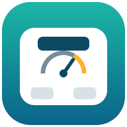

# afu_scale — AFU-WL-TZ-A1 蓝牙体脂秤 Home Assistant 集成

自定义集成：蓝牙自动发现、体重/阻抗/电量/充电状态、多用户归属（按体重范围匹配，阻抗平局裁决，陌生读数走"发现卡片"）。

## 安装

- **HACS**：自定义存储库 → `https://github.com/tonyupup/ha-afu-scale`，类别选"集成"，下载后重启 HA。
- **手动**：把 `custom_components/afu_scale/` 拷到 HA 配置目录的 `custom_components/`，重启。

重启后蓝牙会自动发现秤（`AFU-WL-TZ-A1`），确认添加即可。第一次称重定格后（约 8~25 秒）会在
"设置 → 设备与服务"弹出"新用户？"卡片，按提示建用户；之后按体重范围自动识别。

## 目录

- `custom_components/afu_scale/` 集成本体（含 `brand/` 图标）
- `tests/test_matcher.py` 匹配逻辑的离线单测：`python3 -I -m unittest discover -s tests`
- `tests/e2e_pod.py` 对测试 Pod 的端到端脚本

## 连接策略

秤醒着（有人踩上去、屏幕亮着）时广播 iBeacon 样式的包，空闲时只发带 FFB0 服务的普通广播；
我们保持连接时秤不会睡。所以：见到"醒了"才连接；连上后 30 秒没收到任何数据（多半是误唤醒）
或收到数据后 60 秒无新数据就主动断开，然后静默，直到看到普通广播（秤睡着了，通常 1 分钟内）或最长 75 秒，
再等下一次"醒了"。代价：一次称重结束后约 75 秒内再有人踩上去会漏测。
拿不到原始广播字节的扫描器（部分远程代理）退回"随时连接"。

## 协议（实测，AFU-WL-TZ-A1）

秤**睡着时不接受连接**（连接建立后 40 ms 内 HCI 0x3e 失败），踩上去醒了才能连；广播内容醒/睡一样，
HA 只在广播变化时回调，所以集成另外按时间轮询。服务 0xFFB0，写 0xFFB1 握手 `FD 37 00…37`，通知 0xFFB2，20 字节 0xAC 帧：

| 帧 | 识别 | 内容 |
|---|---|---|
| 体重帧 | `[6]==0x02` | `[3:6]` 体重（克，`(b3-0x68)*65536+b4*256+b5`）；`[2]` bit7=稳定；`[11]` 电量（bit7=充电，低 7 位=%） |
| 结果帧 | `[2]==0x02` | 定格后 8~25 秒才到：`[4:6]` 阻抗 Ω（0=没测到，如穿袜子）；`[10:13]` 体重 |

`[8:10]` 在体重帧里是常量 1344，不是阻抗。结果帧里 `[6:8]`（≈400）含义未定。
体脂/水分/肌肉/骨量由集成按通用公式估算，**未对照原厂算法标定**。

## 安全

秤的协议没有配对、认证和加密，附近任何人都能连接并读到读数；无法在 HA 侧修复。
